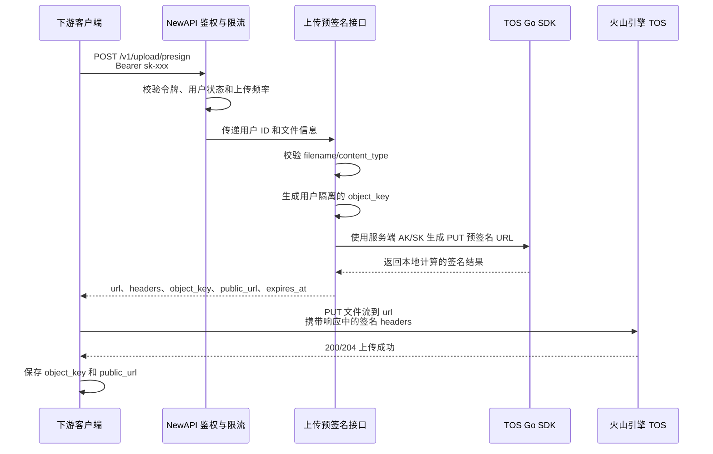

# TOS 文件上传流程

## 1. 目标与范围

本文描述下游客户端通过 NewAPI 获取火山引擎对象存储（TOS）预签名 URL，并将文件直接上传到 TOS 的完整流程。

该方案采用“控制面经过 NewAPI、文件数据直传 TOS”的方式：

- NewAPI 负责用户鉴权、上传限流、对象键生成和 TOS 签名。
- 下游客户端负责读取本地文件并直接上传到 TOS。
- 文件内容不经过 NewAPI，避免占用 NewAPI 的网络带宽和请求内存。
- TOS Access Key 和 Secret Key 只保存在 NewAPI 服务端，不会返回给下游客户端。

## 2. 参与方

| 参与方 | 职责 |
| --- | --- |
| 下游客户端 | 持有 NewAPI Key，请求预签名 URL，并将文件上传到 TOS |
| NewAPI | 校验 API Key、生成对象键、调用 TOS SDK 生成预签名 URL |
| 火山引擎 TOS | 校验预签名参数并接收文件内容 |

## 3. 总体流程



文件数据只出现在客户端到 TOS 的 `PUT` 请求中。NewAPI 的预签名接口只接收文件名和媒体类型。

## 4. 服务端配置

NewAPI 通过以下环境变量读取 TOS 配置：

| 环境变量 | 必填 | 默认值 | 说明 |
| --- | --- | --- | --- |
| `TOS_ACCESS_KEY` | 是 | 无 | 火山引擎访问密钥 ID |
| `TOS_SECRET_KEY` | 是 | 无 | 火山引擎访问密钥 Secret |
| `TOS_ENDPOINT` | 是 | 无 | TOS 区域 Endpoint，例如 `https://tos-cn-beijing.volces.com` |
| `TOS_REGION` | 是 | 无 | TOS 区域，例如 `cn-beijing` |
| `TOS_BUCKET` | 是 | 无 | 目标 Bucket 名称 |
| `TOS_UPLOAD_PREFIX` | 否 | `uploads` | 上传对象键前缀 |
| `TOS_UPLOAD_PRESIGN_EXPIRES` | 否 | `900` | 上传 URL 有效期，单位为秒，范围为 1 至 604800 |

预签名接口限流配置：

| 环境变量 | 默认值 | 说明 |
| --- | --- | --- |
| `UPLOAD_RATE_LIMIT_ENABLE` | `true` | 是否启用预签名接口限流 |
| `UPLOAD_RATE_LIMIT` | `100` | 每个 API Key 在限流周期内最多申请的 URL 数量 |
| `UPLOAD_RATE_LIMIT_DURATION` | `60` | 限流周期，单位为秒 |

示例：

```env
TOS_ACCESS_KEY=your-access-key
TOS_SECRET_KEY=your-secret-key
TOS_ENDPOINT=https://tos-cn-beijing.volces.com
TOS_REGION=cn-beijing
TOS_BUCKET=your-bucket
TOS_UPLOAD_PREFIX=uploads
TOS_UPLOAD_PRESIGN_EXPIRES=900
```

使用 Docker Compose 部署时，宿主机 `.env` 不会自动成为容器环境。项目的 `docker-compose.yml` 和 `docker-compose.dev.yml` 已显式将上述变量注入 NewAPI 容器。修改配置后需要重新创建容器：

```bash
docker compose up -d --build new-api
```

## 5. 获取预签名上传 URL

### 5.1 请求

```http
POST /v1/upload/presign HTTP/1.1
Authorization: Bearer sk-your-new-api-key
Content-Type: application/json

{
  "filename": "photo.png",
  "content_type": "image/png"
}
```

请求字段：

| 字段 | 必填 | 说明 |
| --- | --- | --- |
| `filename` | 是 | 原始文件名，最大 255 字节；服务端只保留安全的扩展名 |
| `content_type` | 否 | 文件媒体类型；未提供时使用 `application/octet-stream` |

接口使用 `middleware.TokenAuth()` 验证 NewAPI Key，并使用按 API Key 对应令牌 ID 统计的上传限流中间件限制调用频率。默认每个 API Key 60 秒最多申请 100 个预签名 URL。实际文件直传 TOS 不消耗该额度。鉴权成功后，用户 ID 会写入请求上下文，用于生成用户隔离的对象键。

### 5.2 对象键生成规则

对象键由服务端生成，客户端不能指定：

```text
{TOS_UPLOAD_PREFIX}/{user_id}/{UTC年}/{UTC月}/{UTC日}/{UUID}.{扩展名}
```

示例：

```text
uploads/123/2026/07/22/6ca7b7c8-31ab-46ef-85a2-d603eddf72c1.png
```

该规则具有以下作用：

- 使用用户 ID 隔离不同用户的对象命名空间。
- 使用 UUID 避免重名文件互相覆盖。
- 不使用客户端传入的完整文件名，避免路径穿越和特殊字符问题。
- 扩展名转为小写，只允许字母、数字和点，最长 16 个字符；不安全的扩展名会被移除。

### 5.3 响应

```json
{
  "url": "https://your-bucket.tos-cn-beijing.volces.com/uploads/123/...?X-Tos-Signature=...",
  "public_url": "https://your-bucket.tos-cn-beijing.volces.com/uploads/123/2026/07/22/uuid.png",
  "method": "PUT",
  "object_key": "uploads/123/2026/07/22/uuid.png",
  "headers": {
    "Content-Type": "image/png"
  },
  "expires_at": 1784682900
}
```

响应字段：

| 字段 | 说明 |
| --- | --- |
| `url` | 临时预签名上传 URL，仅用于本次 `PUT` 上传，应视为临时敏感信息 |
| `public_url` | 不带签名的固定对象地址；仅在 Bucket 或对象允许公共读时可直接访问 |
| `method` | 上传方法，当前固定为 `PUT` |
| `object_key` | TOS 对象键，业务侧应持久化保存该值 |
| `headers` | 已参与签名的请求头，上传时必须原样携带 |
| `expires_at` | 预签名上传 URL 的过期时间，Unix 秒 |

`expires_at` 只表示 `url` 的签名有效期，不表示 `public_url` 的有效期，也不会自动删除已上传对象。

## 6. 使用预签名 URL 上传文件

客户端必须使用响应中的 `method`、`url` 和 `headers`。当前服务端将 `Content-Type` 加入签名，因此上传请求中的 `Content-Type` 必须与申请预签名 URL 时一致，否则 TOS 会返回 403。

```bash
curl -X PUT "$UPLOAD_URL" \
  -H "Content-Type: image/png" \
  --data-binary @photo.png
```

成功上传时，TOS 通常返回 HTTP 200 或 204，并可能通过响应头返回 `ETag`、`x-tos-request-id` 等信息。TOS 的 `PUT` 接口通常没有 JSON 响应体，也不会在上传响应中生成公网下载链接。

当前预签名接口没有限制文件大小。Node.js 客户端会发送 `Content-Length`，但服务端签名本身没有设置文件大小条件。如需强制限制上传大小，需要进一步使用带内容长度条件的上传策略，或在上传后通过 TOS 元数据检查并清理超限对象。

## 7. 公网地址与访问权限

服务端按以下格式生成 `public_url`：

```text
https://{bucket}.{endpoint-host}/{object_key}
```

例如：

```text
https://your-bucket.tos-cn-beijing.volces.com/uploads/123/2026/07/22/uuid.png
```

返回该地址不代表对象一定可以匿名下载：

- Bucket 或对象为公共读时，可以直接访问 `public_url`。
- Bucket 为私有时，访问 `public_url` 会返回 403。
- 私有文件应保存 `object_key`，在需要访问时由后端生成绑定 `GET` 方法的临时下载 URL。
- 如果使用 TOS 自定义域名或 CDN，业务侧应使用相应域名生成对外地址；当前实现使用 `TOS_ENDPOINT` 拼接默认 TOS 域名。

## 8. Node.js 客户端

项目提供零依赖 Node.js 客户端：

```text
scripts/tos-upload-client.mjs
```

运行环境要求 Node.js 18 或更高版本。

PowerShell 示例：

```powershell
$env:NEW_API_BASE_URL = "http://localhost:3000"
$env:NEW_API_KEY = "sk-your-new-api-key"
node scripts/tos-upload-client.mjs --file "C:\path\to\photo.png"
```

客户端内部执行以下步骤：

1. 检查文件是否存在且为普通文件。
2. 根据扩展名推断 `Content-Type`，无法识别时使用 `application/octet-stream`。
3. 携带 NewAPI Key 请求 `/v1/upload/presign`。
4. 校验响应中是否包含 `url`、`public_url`、`method`、`object_key`、`headers` 和 `expires_at`。
5. 使用文件流向 TOS 发起 `PUT` 请求，避免将整个文件加载到内存。
6. 携带签名响应中的请求头，并补充 `Content-Length`。
7. 上传成功后输出 `objectKey`、`publicUrl`、文件大小、媒体类型和签名过期时间。

NewAPI Key 只用于第 3 步，不会被加入 TOS 上传请求。

## 9. 错误处理

### 9.1 NewAPI 接口错误

| HTTP 状态码 | 错误码 | 常见原因 |
| --- | --- | --- |
| 400 | `invalid_request_body` | 请求体不是合法 JSON |
| 400 | `invalid_upload_request` | 用户 ID、文件名或媒体类型不合法 |
| 401/403 | 鉴权错误码 | API Key 无效、用户被禁用、IP 限制不匹配或分组无权限 |
| 429 | 限流错误 | 预签名请求超过上传接口频率限制；默认每个 API Key 60 秒 100 次 |
| 503 | `upload_service_unavailable` | TOS 必填环境变量缺失或配置不合法 |
| 500 | `upload_presign_failed` | TOS SDK 生成签名失败 |

服务端不会把 TOS Access Key 或 Secret Key 返回给客户端。配置类错误的详细原因只写入服务端日志，接口统一返回“上传服务未配置”。

### 9.2 TOS 上传错误

| 现象 | 常见原因 | 处理方式 |
| --- | --- | --- |
| 403 SignatureDoesNotMatch | `Content-Type` 与签名值不一致、URL 被修改 | 原样使用响应中的 `headers` 和 `url` |
| 403 AccessDenied | URL 已过期、AK/SK 无权限、Bucket 策略拒绝 | 重新申请 URL，并检查 TOS IAM 和 Bucket Policy |
| 404 NoSuchBucket | Bucket 或 Region 配置错误 | 核对 `TOS_BUCKET`、`TOS_REGION` 和 `TOS_ENDPOINT` |
| 网络超时 | 文件较大或网络不稳定 | 调大客户端 `--timeout-ms`，重新申请 URL 后重试 |
| 上传成功但访问 `public_url` 返回 403 | Bucket/对象不是公共读 | 配置公共读，或改用预签名 GET 下载 URL |

预签名 URL 过期后不能复用。重试上传时应重新请求 `/v1/upload/presign`，避免继续使用旧 URL。

## 10. 安全边界

- 不要在日志、数据库或错误上报中长期保存完整的预签名 `url`，其中包含临时签名参数。
- 不要把 `TOS_ACCESS_KEY` 和 `TOS_SECRET_KEY` 放入客户端、前端包或接口响应。
- 生产环境的 NewAPI 地址应使用 HTTPS；Node.js 客户端只允许非本机地址使用 HTTPS。
- 当前对象键包含用户 ID，但路径本身不是授权凭据。后续实现删除、查询或私有下载接口时，仍需在服务端校验对象归属。
- 公共读对象一旦泄露 `public_url`，任何人都可以访问。敏感文件应使用私有 Bucket 和临时 GET URL。
- TOS 凭据应遵循最小权限原则，仅授予目标 Bucket 和所需对象操作权限。

## 11. 相关代码

| 模块 | 文件 |
| --- | --- |
| 路由和鉴权 | `router/relay-router.go` |
| HTTP 控制器 | `controller/upload.go` |
| 请求和响应 DTO | `dto/upload.go` |
| TOS 配置、对象键和签名逻辑 | `service/tos_upload.go` |
| 后端测试 | `controller/upload_test.go`、`service/tos_upload_test.go` |
| Node.js 客户端 | `scripts/tos-upload-client.mjs` |
| Node.js 客户端测试 | `scripts/tos-upload-client.test.mjs` |
| OpenAPI 定义 | `docs/openapi/relay.json` |
